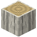

# Birkenstamm

| Eigenschaft | Wert |
|---|---|
| Art | fester Block |
| Abbauen | 3 s mit der Hand, schneller mit Axt |

## Verwendet für

[Birkenholzbretter](../bloecke/birkenholzbretter.md), [Birkenholz](../bloecke/birkenholz.md), [Entrindeter Birkenstamm](../bloecke/entrindeter_birkenstamm.md)

