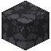

# Bruchgneis

| Eigenschaft | Wert |
|---|---|
| Art | fester Block |
| Abbauen | 15 s mit der Hand, schneller mit Spitzhacke |

## Im Ofen

1 × Bruchgneis → 1 × [Gneis](../bloecke/gneis.md)

## Verwendet für

[Steinspitzhacke](../gegenstaende/steinspitzhacke.md), [Steinaxt](../gegenstaende/steinaxt.md), [Ofen](../gegenstaende/ofen.md), [Steinschwert](../gegenstaende/steinschwert.md), [Bruchgneisstufe](../bloecke/bruchgneisstufe.md), [Bruchgneistreppe](../bloecke/bruchgneistreppe.md), [Bruchgneismauer](../bloecke/bruchgneismauer.md), [Gneis](../bloecke/gneis.md), [Polierter Gneis](../bloecke/polierter_gneis.md)

