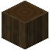

# Entrindeter Schwarzeichenstamm

| Eigenschaft | Wert |
|---|---|
| Art | fester Block |
| Abbauen | 3 s mit der Hand, schneller mit Axt |

## Herstellen

- 1 × [Schwarzeichenstamm](../bloecke/schwarzeichenstamm.md) → 1 × [Entrindeter Schwarzeichenstamm](../bloecke/entrindeter_schwarzeichenstamm.md) (Werkbank, 1 s)

## Verwendet für

[Entrindetes Schwarzeichenholz](../bloecke/entrindetes_schwarzeichenholz.md)

