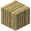

# Entrindetes Birkenholz

| Eigenschaft | Wert |
|---|---|
| Art | fester Block |
| Abbauen | 3 s mit der Hand, schneller mit Axt |

## Herstellen

- 4 × [Entrindeter Birkenstamm](../bloecke/entrindeter_birkenstamm.md) → 3 × [Entrindetes Birkenholz](../bloecke/entrindetes_birkenholz.md) (von Hand, 1 s)

