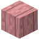

# Entrindetes Kirschholz

| Eigenschaft | Wert |
|---|---|
| Art | fester Block |
| Abbauen | 3 s mit der Hand, schneller mit Axt |

## Herstellen

- 4 × [Entrindeter Kirschstamm](../bloecke/entrindeter_kirschstamm.md) → 3 × [Entrindetes Kirschholz](../bloecke/entrindetes_kirschholz.md) (von Hand, 1 s)

## Verwendet für

[Kirschholzbretter](../bloecke/kirschholzbretter.md)

