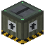

# Frachthafen

| Eigenschaft | Wert |
|---|---|
| Art | fester Block |
| Abbauen | 7,5 s mit der Hand, schneller mit Spitzhacke |

## Herstellen

- 4 × [Verstärkte Eisenplatte](../gegenstaende/verstaerkte_eisenplatte.md) + 2 × [Kiste](../gegenstaende/kiste.md) + 2 × [Quarzkristall](../gegenstaende/quarzkristall.md) + 6 × [Kabel](../gegenstaende/kabel.md) → 1 × [Frachthafen](../bloecke/frachthafen.md) (Werkbank, 25 s)

