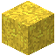

# Gelber Trockenbeton

| Eigenschaft | Wert |
|---|---|
| Art | fester Block |
| Abbauen | 0,75 s |

## Herstellen

- 4 × [Sand](../bloecke/sand.md) + 4 × [Kies](../bloecke/kies.md) + 1 × [Gelber Farbstoff](../gegenstaende/gelber_farbstoff.md) → 8 × [Gelber Trockenbeton](../bloecke/gelber_trockenbeton.md) (Werkbank, 2 s)

