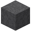

# Gneis

| Eigenschaft | Wert |
|---|---|
| Art | fester Block |
| Abbauen | 15 s mit der Hand, schneller mit Spitzhacke |

## Herstellen

- 1 × [Bruchgneis](../bloecke/bruchgneis.md) → 1 × [Gneis](../bloecke/gneis.md) (Ofen, 5 s)

