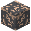

# Gneis-Eisenerz

| Eigenschaft | Wert |
|---|---|
| Art | fester Block |
| Abbauen | nur mit Steinspitzhacke oder besser |

## Im Ofen

1 × Gneis-Eisenerz → 1 × [Eisenbarren](../elemente/eisenbarren.md)

## Verwendet für

[Eisenbarren](../elemente/eisenbarren.md)

