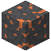

# Gneis-Kupfererz

| Eigenschaft | Wert |
|---|---|
| Art | fester Block |
| Abbauen | nur mit Steinspitzhacke oder besser |

## Im Ofen

1 × Gneis-Kupfererz → 1 × [Kupferbarren](../elemente/kupferbarren.md)

## Verwendet für

[Kupferbarren](../elemente/kupferbarren.md)

