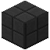

# Gneisfliesenmauer

| Eigenschaft | Wert |
|---|---|
| Art | fest, eigene Form |
| Abbauen | 15 s mit der Hand, schneller mit Spitzhacke |

## Herstellen

- 6 × [Gneisfliesen](../bloecke/gneisfliesen.md) → 6 × [Gneisfliesenmauer](../bloecke/gneisfliesenmauer.md) (Werkbank, 2 s)

