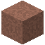

# Granit

| Eigenschaft | Wert |
|---|---|
| Art | fester Block |
| Abbauen | 7,5 s mit der Hand, schneller mit Spitzhacke |
| Gibt es auf | [Erde](../himmelskoerper/erde.md) |

## Herstellen

- 1 × [Diorit](../bloecke/diorit.md) + 1 × [Quarzkristall](../gegenstaende/quarzkristall.md) → 1 × [Granit](../bloecke/granit.md) (Werkbank, 2 s)

## Verwendet für

[Granitstufe](../bloecke/granitstufe.md), [Granittreppe](../bloecke/granittreppe.md), [Granitmauer](../bloecke/granitmauer.md), [Polierter Granit](../bloecke/polierter_granit.md)

