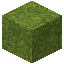

# Grüner Trockenbeton

| Eigenschaft | Wert |
|---|---|
| Art | fester Block |
| Abbauen | 0,75 s |

## Herstellen

- 4 × [Sand](../bloecke/sand.md) + 4 × [Kies](../bloecke/kies.md) + 1 × [Grüner Farbstoff](../gegenstaende/gruener_farbstoff.md) → 8 × [Grüner Trockenbeton](../bloecke/gruener_trockenbeton.md) (Werkbank, 2 s)

