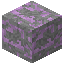

# Lepidolith

Lila Glimmer – Lithium, Rubidium und Caesium in einem Stein.

| Eigenschaft | Wert |
|---|---|
| Art | fester Block |
| Abbauen | nur mit Steinspitzhacke oder besser |
| Gibt es auf | [Erde](../himmelskoerper/erde.md) |

## Verwendet für

[Rubidium](../elemente/rubidium.md), [Caesium](../elemente/caesium.md)

