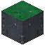

# Platinenwerkbank

| Eigenschaft | Wert |
|---|---|
| Art | fester Block |
| Abbauen | 7,5 s mit der Hand, schneller mit Spitzhacke |

## Herstellen

- 4 × [Eisenplatte](../gegenstaende/eisenplatte.md) + 1 × [Quarzkristall](../gegenstaende/quarzkristall.md) + 4 × [Kupferdraht](../gegenstaende/kupferdraht.md) + 1 × [Glas](../bloecke/glas.md) → 1 × [Platinenwerkbank](../bloecke/platinenwerkbank.md) (Werkbank, 6 s)

