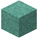

# Prismarinmauer

| Eigenschaft | Wert |
|---|---|
| Art | fest, eigene Form |
| Abbauen | 7,5 s mit der Hand, schneller mit Spitzhacke |

## Herstellen

- 6 × [Prismarin](../bloecke/prismarin.md) → 6 × [Prismarinmauer](../bloecke/prismarinmauer.md) (Werkbank, 2 s)

