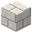

# Quarzziegel

| Eigenschaft | Wert |
|---|---|
| Art | fester Block |
| Abbauen | 10 s mit der Hand, schneller mit Spitzhacke |

## Herstellen

- 4 × [Quarzblock](../bloecke/quarzblock.md) → 4 × [Quarzziegel](../bloecke/quarzziegel.md) (Werkbank, 1,5 s)

