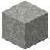

# Regolith

| Eigenschaft | Wert |
|---|---|
| Art | fester Block |
| Abbauen | 0,75 s |
| Vorkommen | Mond, Merkur |
| Gibt es auf | [Merkur](../himmelskoerper/merkur.md), [Mond](../himmelskoerper/mond.md) |

## Im Ofen

2 × Regolith → 1 × [Regolithziegel](../bloecke/regolithziegel.md)

## Verwendet für

[Regolithziegel](../bloecke/regolithziegel.md), [Helium-3](../gegenstaende/helium_3.md)

