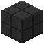

# Rissige Gneisfliesen

| Eigenschaft | Wert |
|---|---|
| Art | fester Block |
| Abbauen | 15 s mit der Hand, schneller mit Spitzhacke |

## Herstellen

- 1 × [Gneisfliesen](../bloecke/gneisfliesen.md) → 1 × [Rissige Gneisfliesen](../bloecke/rissige_gneisfliesen.md) (Ofen, 5 s)

