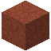

# Roter Fels

| Eigenschaft | Wert |
|---|---|
| Art | fester Block |
| Abbauen | 7,5 s mit der Hand, schneller mit Spitzhacke |
| Vorkommen | Mars |
| Gibt es auf | [Mars](../himmelskoerper/mars.md), [Gonggong](../himmelskoerper/gonggong.md), [Sedna](../himmelskoerper/sedna.md), [Deimos](../himmelskoerper/deimos.md), [Io](../himmelskoerper/io.md), [Amalthea](../himmelskoerper/amalthea.md), [Oberon](../himmelskoerper/oberon.md), [Sycorax](../himmelskoerper/sycorax.md), [Thebe](../himmelskoerper/thebe.md), [Adrastea](../himmelskoerper/adrastea.md), [Metis](../himmelskoerper/metis.md) |

