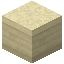

# Sandsteintreppe

| Eigenschaft | Wert |
|---|---|
| Art | fest, eigene Form |
| Abbauen | 4 s mit der Hand, schneller mit Spitzhacke |

## Herstellen

- 6 × [Sandstein](../bloecke/sandstein.md) → 4 × [Sandsteintreppe](../bloecke/sandsteintreppe.md) (Werkbank, 2 s)

