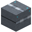

# Scharnier

| Eigenschaft | Wert |
|---|---|
| Art | fester Block |
| Abbauen | 7,5 s mit der Hand, schneller mit Spitzhacke |

## Herstellen

- 1 × [Verstärkte Eisenplatte](../gegenstaende/verstaerkte_eisenplatte.md) + 1 × [Eisenstange](../gegenstaende/eisenstange.md) + 1 × [Elektromotor](../bloecke/elektromotor.md) + 2 × [Schrauben](../gegenstaende/schrauben.md) → 1 × [Scharnier](../bloecke/scharnier.md) (Werkbank, 6 s)

