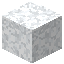

# Schnee

| Eigenschaft | Wert |
|---|---|
| Art | fester Block |
| Abbauen | 0,75 s |
| Gibt es auf | [Eris](../himmelskoerper/eris.md), [Makemake](../himmelskoerper/makemake.md), [Enceladus](../himmelskoerper/enceladus.md), [Dione](../himmelskoerper/dione.md), [Iapetus](../himmelskoerper/iapetus.md), [Ariel](../himmelskoerper/ariel.md) |

## Verwendet für

[Schneeschicht](../bloecke/schneeschicht.md)

