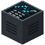

# Steuerpult

| Eigenschaft | Wert |
|---|---|
| Art | fester Block |
| Abbauen | 7,5 s mit der Hand, schneller mit Spitzhacke |
| Leuchtet | Stärke 3 von 15 |

## Herstellen

- 2 × [Eisenplatte](../gegenstaende/eisenplatte.md) + 2 × [Quarzkristall](../gegenstaende/quarzkristall.md) + 4 × [Kupferdraht](../gegenstaende/kupferdraht.md) + 1 × [Kupferbarren](../elemente/kupferbarren.md) → 1 × [Steuerpult](../bloecke/steuerpult.md) (Werkbank, 6 s)

