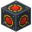

# Taster

| Eigenschaft | Wert |
|---|---|
| Art | fester Block |
| Abbauen | 7,5 s mit der Hand, schneller mit Spitzhacke |

## Herstellen

- 1 × [Eisenplatte](../gegenstaende/eisenplatte.md) + 2 × [Kupferdraht](../gegenstaende/kupferdraht.md) + 1 × [Gummi](../gegenstaende/gummi.md) → 1 × [Taster](../bloecke/taster.md) (Werkbank, 2 s)

