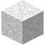

# Weiße Wolle

| Eigenschaft | Wert |
|---|---|
| Art | fester Block |
| Abbauen | 1,2 s |

## Herstellen

- 1 × [Weiße Wolle](../bloecke/weisse_wolle.md) oder [Orange Wolle](../bloecke/orange_wolle.md) oder [Magenta Wolle](../bloecke/magenta_wolle.md) (oder eins von 13 weiteren) + 1 × [Weißer Farbstoff](../gegenstaende/weisser_farbstoff.md) → 1 × [Weiße Wolle](../bloecke/weisse_wolle.md) (Werkbank, 0,5 s)
- 4 × [Faden](../gegenstaende/faden.md) → 1 × [Weiße Wolle](../bloecke/weisse_wolle.md) (von Hand, 1 s)

## Verwendet für

[Weiße Wolle](../bloecke/weisse_wolle.md), [Weißer Teppich](../bloecke/weisser_teppich.md), [Weißes Bett](../bloecke/weisses_bett.md), [Orange Wolle](../bloecke/orange_wolle.md), [Magenta Wolle](../bloecke/magenta_wolle.md), [Hellblaue Wolle](../bloecke/hellblaue_wolle.md), [Gelbe Wolle](../bloecke/gelbe_wolle.md), [Hellgrüne Wolle](../bloecke/hellgruene_wolle.md), [Rosa Wolle](../bloecke/rosa_wolle.md), [Graue Wolle](../bloecke/graue_wolle.md), [Hellgraue Wolle](../bloecke/hellgraue_wolle.md), [Türkise Wolle](../bloecke/tuerkise_wolle.md), [Violette Wolle](../bloecke/violette_wolle.md), [Blaue Wolle](../bloecke/blaue_wolle.md), [Braune Wolle](../bloecke/braune_wolle.md), [Grüne Wolle](../bloecke/gruene_wolle.md), [Rote Wolle](../bloecke/rote_wolle.md), [Schwarze Wolle](../bloecke/schwarze_wolle.md)

