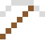
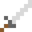

# Actinium

Strahlt so stark, dass es im Dunkeln bläulich leuchtet.

| Eigenschaft | Wert |
|---|---|
| Symbol | Ac |
| Ordnungszahl | 89 |
| Gruppe | Actinoid |
| Zustand (20 °C) | fest |
| Dichte | 10,07 g/cm³ |
| Schmilzt bei | 1050 °C |
| Härte (Mohs) | 2,5 |
| Radioaktiv | ja, Halbwertszeit 21,8 Jahre |
| Ausrüstung daraus | ja |

## Herstellen

- 1 × [Radium](../elemente/radium.md) + 1 × [Uranbrennstab](../gegenstaende/uranbrennstab.md) → 1 × [Actinium](../elemente/actinium.md) (Forschungsreaktor, 90 s)

## Ausrüstung

Aus Actinium gibt es Werkzeuge, Waffen und Rüstung (Stufe 1):

-  Actiniumspitzhacke: 3 × Actinium + 2 × Bretter
-  Actiniumaxt: 3 × Actinium + 2 × Bretter
-  Actiniumschwert: 2 × Actinium + 1 × Bretter
-  Actiniumhelm: 5 × Actinium
-  Actiniumharnisch: 8 × Actinium
-  Actiniumbeinschutz: 7 × Actinium
-  Actiniumstiefel: 4 × Actinium

