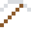

# Aluminiumbarren

War einmal teurer als Gold: Napoleon III. ließ seine Ehrengäste mit Aluminiumbesteck essen. Dann kam die Elektrolyse.

| Eigenschaft | Wert |
|---|---|
| Symbol | Al |
| Ordnungszahl | 13 |
| Gruppe | Metall |
| Zustand (20 °C) | fest |
| Dichte | 2,7 g/cm³ |
| Schmilzt bei | 660 °C |
| Härte (Mohs) | 2,8 |
| Radioaktiv | nein, stabil |
| Ausrüstung daraus | ja |

## Herstellen

- 1 × [Bauxit](../bloecke/bauxit.md) oder [Anorthosit](../bloecke/anorthosit.md) → 1 × [Aluminiumbarren](../elemente/aluminiumbarren.md) (Ofen, 6 s)

## Ausrüstung

Aus Aluminiumbarren gibt es Werkzeuge, Waffen und Rüstung (Stufe 1):

-  Aluminiumspitzhacke: 3 × Aluminiumbarren + 2 × Bretter
-  Aluminiumaxt: 3 × Aluminiumbarren + 2 × Bretter
-  Aluminiumschwert: 2 × Aluminiumbarren + 1 × Bretter
-  Aluminiumhelm: 5 × Aluminiumbarren
-  Aluminiumharnisch: 8 × Aluminiumbarren
-  Aluminiumbeinschutz: 7 × Aluminiumbarren
-  Aluminiumstiefel: 4 × Aluminiumbarren

## Verwendet für

[Aluminiumblech](../gegenstaende/aluminiumblech.md), [Aluminiumblock](../bloecke/aluminiumblock.md), [Hochspannungskabel](../gegenstaende/hochspannungskabel.md), [Barium](../elemente/barium.md), [Chrom](../elemente/chrom.md), [Mangan](../elemente/mangan.md), [Duraluminium](../legierungen/duraluminium.md), [Magnesiumlegierung](../legierungen/magnesiumlegierung.md), [Aluminium-Vanadium](../legierungen/aluminium_vanadium.md), [Alnico](../legierungen/alnico.md), [Zamak](../legierungen/zamak.md), [Aluminiumbronze](../legierungen/aluminiumbronze.md), [Saphir](../gegenstaende/saphir.md)

