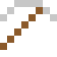
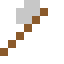
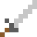

# Berkelium

Für die Entdeckung von Tenness brauchte man 22 Milligramm – die herzustellen dauerte 250 Tage.

| Eigenschaft | Wert |
|---|---|
| Symbol | Bk |
| Ordnungszahl | 97 |
| Gruppe | Actinoid |
| Zustand (20 °C) | fest |
| Dichte | 14,78 g/cm³ |
| Schmilzt bei | 986 °C |
| Härte (Mohs) | 3 |
| Radioaktiv | ja, Halbwertszeit 1380 Jahre |
| Ausrüstung daraus | ja |

## Herstellen

- 4 × [Curium](../elemente/curium.md) + 2 × [Uranbrennstab](../gegenstaende/uranbrennstab.md) → 1 × [Berkelium](../elemente/berkelium.md) (Forschungsreaktor, 200 s)

## Ausrüstung

Aus Berkelium gibt es Werkzeuge, Waffen und Rüstung (Stufe 1):

-  [Berkeliumspitzhacke](../elemente/berkelium.md): 3 × Berkelium + 2 × Bretter
-  [Berkeliumaxt](../elemente/berkelium.md): 3 × Berkelium + 2 × Bretter
-  [Berkeliumschwert](../elemente/berkelium.md): 2 × Berkelium + 1 × Bretter
-  [Berkeliumhelm](../gegenstaende/berkeliumhelm.md): 5 × Berkelium
-  [Berkeliumharnisch](../gegenstaende/berkeliumharnisch.md): 8 × Berkelium
-  [Berkeliumbeinschutz](../gegenstaende/berkeliumbeinschutz.md): 7 × Berkelium
-  [Berkeliumstiefel](../gegenstaende/berkeliumstiefel.md): 4 × Berkelium

## Verwendet für

[Californium](../elemente/californium.md), [Tenness](../elemente/tenness.md)

