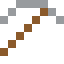

# Beryllium

Leichter als Aluminium, steifer als Stahl. Die Spiegel des James-Webb-Teleskops sind aus Beryllium.

| Eigenschaft | Wert |
|---|---|
| Symbol | Be |
| Ordnungszahl | 4 |
| Gruppe | Erdalkalimetall |
| Zustand (20 °C) | fest |
| Dichte | 1,85 g/cm³ |
| Schmilzt bei | 1287 °C |
| Härte (Mohs) | 5,5 |
| Radioaktiv | nein, stabil |
| Ausrüstung daraus | ja |

## Herstellen

- 2 × [Beryll](../bloecke/beryll.md) + 1 × [Magnesium](../elemente/magnesium.md) → 1 × [Beryllium](../elemente/beryllium.md) (Chemiereaktor, 15 s)

## Ausrüstung

Aus Beryllium gibt es Werkzeuge, Waffen und Rüstung (Stufe 3):

-  [Berylliumspitzhacke](../elemente/beryllium.md): 3 × Beryllium + 2 × Bretter
-  [Berylliumaxt](../elemente/beryllium.md): 3 × Beryllium + 2 × Bretter
-  [Berylliumschwert](../elemente/beryllium.md): 2 × Beryllium + 1 × Bretter
-  [Berylliumhelm](../gegenstaende/berylliumhelm.md): 5 × Beryllium
-  [Berylliumharnisch](../gegenstaende/berylliumharnisch.md): 8 × Beryllium
-  [Berylliumbeinschutz](../gegenstaende/berylliumbeinschutz.md): 7 × Beryllium
-  [Berylliumstiefel](../gegenstaende/berylliumstiefel.md): 4 × Beryllium

## Verwendet für

[Berylliumkupfer](../legierungen/berylliumkupfer.md)

