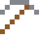

# Blei

Hält Strahlung ab. Die Römer süßten ihren Wein mit Bleizucker.

| Eigenschaft | Wert |
|---|---|
| Symbol | Pb |
| Ordnungszahl | 82 |
| Gruppe | Metall |
| Zustand (20 °C) | fest |
| Dichte | 11,34 g/cm³ |
| Schmilzt bei | 327 °C |
| Härte (Mohs) | 1,5 |
| Radioaktiv | nein, stabil |
| Ausrüstung daraus | ja |

## Herstellen

- 1 × [Bleiglanz](../bloecke/bleiglanz.md) → 1 × [Blei](../elemente/blei.md) (Ofen, 5 s)

## Ausrüstung

Aus Blei gibt es Werkzeuge, Waffen und Rüstung (Stufe 1):

-  Bleispitzhacke: 3 × Blei + 2 × Bretter
-  Bleiaxt: 3 × Blei + 2 × Bretter
-  Bleischwert: 2 × Blei + 1 × Bretter
-  Bleihelm: 5 × Blei
-  Bleiharnisch: 8 × Blei
-  Bleibeinschutz: 7 × Blei
-  Bleistiefel: 4 × Blei

## Verwendet für

[Silber](../elemente/silber.md), [Hassium](../elemente/hassium.md), [Darmstadtium](../elemente/darmstadtium.md), [Copernicium](../elemente/copernicium.md), [Woodsches Metall](../legierungen/woodsches_metall.md)

