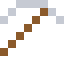
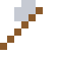

# Cadmium

Giftig – aber in alten Akkus und leuchtend gelben Malerfarben.

| Eigenschaft | Wert |
|---|---|
| Symbol | Cd |
| Ordnungszahl | 48 |
| Gruppe | Übergangsmetall |
| Zustand (20 °C) | fest |
| Dichte | 8,65 g/cm³ |
| Schmilzt bei | 321 °C |
| Härte (Mohs) | 2 |
| Radioaktiv | nein, stabil |
| Ausrüstung daraus | ja |

## Herstellen

- 2 × [Zinkrückstand](../gegenstaende/zinkrueckstand.md) → 1 × [Cadmium](../elemente/cadmium.md) (Trennanlage, 12 s)

## Ausrüstung

Aus Cadmium gibt es Werkzeuge, Waffen und Rüstung (Stufe 1):

-  Cadmiumspitzhacke: 3 × Cadmium + 2 × Bretter
-  Cadmiumaxt: 3 × Cadmium + 2 × Bretter
-  Cadmiumschwert: 2 × Cadmium + 1 × Bretter
-  Cadmiumhelm: 5 × Cadmium
-  Cadmiumharnisch: 8 × Cadmium
-  Cadmiumbeinschutz: 7 × Cadmium
-  Cadmiumstiefel: 4 × Cadmium

