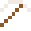

# Calcium

Knochen, Zähne, Muscheln, Kalkstein, Marmor – alles Calcium. Als Metall ist es silbern.

| Eigenschaft | Wert |
|---|---|
| Symbol | Ca |
| Ordnungszahl | 20 |
| Gruppe | Erdalkalimetall |
| Zustand (20 °C) | fest |
| Dichte | 1,55 g/cm³ |
| Schmilzt bei | 842 °C |
| Härte (Mohs) | 1,8 |
| Radioaktiv | nein, stabil |
| Ausrüstung daraus | ja |
| Im Wasser | sprudelt |

## Im Wasser

Ca + 2 H2O → Ca(OH)2 + H2: Calcium sinkt und sprudelt kräftig, das Wasser wird trüb (Kalkmilch).

## Herstellen

- 2 × [Kalkstein](../bloecke/kalkstein.md) + 1 × [Salzsäure](../gegenstaende/salzsaeure.md) → 1 × [Calcium](../elemente/calcium.md) (Elektrolyseanlage, 10 s)

## Ausrüstung

Aus Calcium gibt es Werkzeuge, Waffen und Rüstung (Stufe 1):

-  Calciumspitzhacke: 3 × Calcium + 2 × Bretter
-  Calciumaxt: 3 × Calcium + 2 × Bretter
-  Calciumschwert: 2 × Calcium + 1 × Bretter
-  Calciumhelm: 5 × Calcium
-  Calciumharnisch: 8 × Calcium
-  Calciumbeinschutz: 7 × Calcium
-  Calciumstiefel: 4 × Calcium

## Verwendet für

[Flerovium](../elemente/flerovium.md), [Moscovium](../elemente/moscovium.md), [Livermorium](../elemente/livermorium.md), [Tenness](../elemente/tenness.md), [Oganesson](../elemente/oganesson.md)

