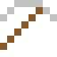
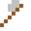

# Californium

Ein Mikrogramm sprüht über 100 Millionen Neutronen pro Minute – zum Anfahren von Reaktoren und Aufspüren von Öl.

| Eigenschaft | Wert |
|---|---|
| Symbol | Cf |
| Ordnungszahl | 98 |
| Gruppe | Actinoid |
| Zustand (20 °C) | fest |
| Dichte | 15,1 g/cm³ |
| Schmilzt bei | 900 °C |
| Härte (Mohs) | 3 |
| Radioaktiv | ja, Halbwertszeit 898 Jahre |
| Ausrüstung daraus | ja |

## Herstellen

- 2 × [Berkelium](../elemente/berkelium.md) + 2 × [Uranbrennstab](../gegenstaende/uranbrennstab.md) → 1 × [Californium](../elemente/californium.md) (Forschungsreaktor, 240 s)

## Ausrüstung

Aus Californium gibt es Werkzeuge, Waffen und Rüstung (Stufe 1):

-  Californiumspitzhacke: 3 × Californium + 2 × Bretter
-  Californiumaxt: 3 × Californium + 2 × Bretter
-  Californiumschwert: 2 × Californium + 1 × Bretter
-  Californiumhelm: 5 × Californium
-  Californiumharnisch: 8 × Californium
-  Californiumbeinschutz: 7 × Californium
-  Californiumstiefel: 4 × Californium

## Verwendet für

[Einsteinium](../elemente/einsteinium.md), [Lawrencium](../elemente/lawrencium.md), [Rutherfordium](../elemente/rutherfordium.md), [Dubnium](../elemente/dubnium.md), [Seaborgium](../elemente/seaborgium.md), [Oganesson](../elemente/oganesson.md)

