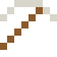
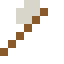

# Cer

Reibt man es, sprühen Funken – der "Feuerstein" im Feuerzeug ist Cer-Eisen.

| Eigenschaft | Wert |
|---|---|
| Symbol | Ce |
| Ordnungszahl | 58 |
| Gruppe | Lanthanoid |
| Zustand (20 °C) | fest |
| Dichte | 6,77 g/cm³ |
| Schmilzt bei | 795 °C |
| Härte (Mohs) | 2,5 |
| Radioaktiv | nein, stabil |
| Ausrüstung daraus | ja |

## Herstellen

- 1 × [Seltenerd-Konzentrat](../gegenstaende/seltenerd_konzentrat.md) → 1 × [Cer](../elemente/cer.md) (Trennanlage, 13 s)

## Ausrüstung

Aus Cer gibt es Werkzeuge, Waffen und Rüstung (Stufe 1):

-  [Cerspitzhacke](../elemente/cer.md): 3 × Cer + 2 × Bretter
-  [Ceraxt](../elemente/cer.md): 3 × Cer + 2 × Bretter
-  [Cerschwert](../elemente/cer.md): 2 × Cer + 1 × Bretter
-  [Cerhelm](../gegenstaende/cerhelm.md): 5 × Cer
-  [Cerharnisch](../gegenstaende/cerharnisch.md): 8 × Cer
-  [Cerbeinschutz](../gegenstaende/cerbeinschutz.md): 7 × Cer
-  [Cerstiefel](../gegenstaende/cerstiefel.md): 4 × Cer

