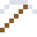
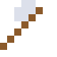
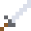

# Chrom

Das härteste reine Metall. Rubine sind rot und Smaragde grün – beides durch Spuren von Chrom.

| Eigenschaft | Wert |
|---|---|
| Symbol | Cr |
| Ordnungszahl | 24 |
| Gruppe | Übergangsmetall |
| Zustand (20 °C) | fest |
| Dichte | 7,19 g/cm³ |
| Schmilzt bei | 1907 °C |
| Härte (Mohs) | 8,5 |
| Radioaktiv | nein, stabil |
| Ausrüstung daraus | ja |

## Herstellen

- 2 × [Chromit](../bloecke/chromit.md) + 1 × [Aluminiumbarren](../elemente/aluminiumbarren.md) → 1 × [Chrom](../elemente/chrom.md) (Induktionsofen, 10 s)

## Ausrüstung

Aus Chrom gibt es Werkzeuge, Waffen und Rüstung (Stufe 4):

-  [Chromspitzhacke](../elemente/chrom.md): 3 × Chrom + 2 × Bretter
-  [Chromaxt](../elemente/chrom.md): 3 × Chrom + 2 × Bretter
-  [Chromschwert](../elemente/chrom.md): 2 × Chrom + 1 × Bretter
-  [Chromhelm](../gegenstaende/chromhelm.md): 5 × Chrom
-  [Chromharnisch](../gegenstaende/chromharnisch.md): 8 × Chrom
-  [Chrombeinschutz](../gegenstaende/chrombeinschutz.md): 7 × Chrom
-  [Chromstiefel](../gegenstaende/chromstiefel.md): 4 × Chrom

## Verwendet für

[Bohrium](../elemente/bohrium.md), [Nichrom](../legierungen/nichrom.md), [Stellit](../legierungen/stellit.md), [Kanthal](../legierungen/kanthal.md)

