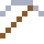
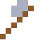

# Cobalt

Cobaltblau färbt seit dem alten Ägypten Glas. Bergleute hielten das giftige Erz für verhext ("Kobold").

| Eigenschaft | Wert |
|---|---|
| Symbol | Co |
| Ordnungszahl | 27 |
| Gruppe | Übergangsmetall |
| Zustand (20 °C) | fest |
| Dichte | 8,9 g/cm³ |
| Schmilzt bei | 1495 °C |
| Härte (Mohs) | 5 |
| Radioaktiv | nein, stabil |
| Ausrüstung daraus | ja |

## Herstellen

- 4 × [Pentlandit](../bloecke/pentlandit.md) + 1 × [Schwefelsäure](../gegenstaende/schwefelsaeure.md) → 1 × [Cobalt](../elemente/cobalt.md) (Chemiereaktor, 12 s)

## Ausrüstung

Aus Cobalt gibt es Werkzeuge, Waffen und Rüstung (Stufe 2):

-  Cobaltspitzhacke: 3 × Cobalt + 2 × Bretter
-  Cobaltaxt: 3 × Cobalt + 2 × Bretter
-  Cobaltschwert: 2 × Cobalt + 1 × Bretter
-  Cobalthelm: 5 × Cobalt
-  Cobaltharnisch: 8 × Cobalt
-  Cobaltbeinschutz: 7 × Cobalt
-  Cobaltstiefel: 4 × Cobalt

## Verwendet für

[Stellit](../legierungen/stellit.md), [Lithium-Ionen-Zelle](../gegenstaende/lithium_ionen_zelle.md)

