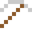
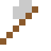
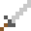

# Curium

Nach Marie und Pierre Curie. Mars-Rover messen damit, woraus Gestein besteht.

| Eigenschaft | Wert |
|---|---|
| Symbol | Cm |
| Ordnungszahl | 96 |
| Gruppe | Actinoid |
| Zustand (20 °C) | fest |
| Dichte | 13,51 g/cm³ |
| Schmilzt bei | 1340 °C |
| Härte (Mohs) | 3 |
| Radioaktiv | ja, Halbwertszeit 15,6 Mio. Jahre |
| Ausrüstung daraus | ja |

## Herstellen

- 2 × [Americium](../elemente/americium.md) + 1 × [Uranbrennstab](../gegenstaende/uranbrennstab.md) → 1 × [Curium](../elemente/curium.md) (Forschungsreaktor, 150 s)

## Ausrüstung

Aus Curium gibt es Werkzeuge, Waffen und Rüstung (Stufe 1):

-  [Curiumspitzhacke](../elemente/curium.md): 3 × Curium + 2 × Bretter
-  [Curiumaxt](../elemente/curium.md): 3 × Curium + 2 × Bretter
-  [Curiumschwert](../elemente/curium.md): 2 × Curium + 1 × Bretter
-  [Curiumhelm](../gegenstaende/curiumhelm.md): 5 × Curium
-  [Curiumharnisch](../gegenstaende/curiumharnisch.md): 8 × Curium
-  [Curiumbeinschutz](../gegenstaende/curiumbeinschutz.md): 7 × Curium
-  [Curiumstiefel](../gegenstaende/curiumstiefel.md): 4 × Curium

## Verwendet für

[Berkelium](../elemente/berkelium.md), [Nobelium](../elemente/nobelium.md), [Livermorium](../elemente/livermorium.md)

