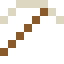

# Europium

Leuchtet rot, wenn man Euro-Scheine unter UV-Licht hält – Schutz gegen Fälschungen.

| Eigenschaft | Wert |
|---|---|
| Symbol | Eu |
| Ordnungszahl | 63 |
| Gruppe | Lanthanoid |
| Zustand (20 °C) | fest |
| Dichte | 5,264 g/cm³ |
| Schmilzt bei | 826 °C |
| Härte (Mohs) | 2 |
| Radioaktiv | nein, stabil |
| Ausrüstung daraus | ja |

## Herstellen

- 4 × [Seltenerd-Konzentrat](../gegenstaende/seltenerd_konzentrat.md) → 1 × [Europium](../elemente/europium.md) (Trennanlage, 22 s)

## Ausrüstung

Aus Europium gibt es Werkzeuge, Waffen und Rüstung (Stufe 1):

-  [Europiumspitzhacke](../elemente/europium.md): 3 × Europium + 2 × Bretter
-  [Europiumaxt](../elemente/europium.md): 3 × Europium + 2 × Bretter
-  [Europiumschwert](../elemente/europium.md): 2 × Europium + 1 × Bretter
-  [Europiumhelm](../gegenstaende/europiumhelm.md): 5 × Europium
-  [Europiumharnisch](../gegenstaende/europiumharnisch.md): 8 × Europium
-  [Europiumbeinschutz](../gegenstaende/europiumbeinschutz.md): 7 × Europium
-  [Europiumstiefel](../gegenstaende/europiumstiefel.md): 4 × Europium

