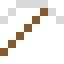

# Gadolinium

Wird nur unter 20 °C magnetisch: An kühlen Tagen klebt es am Magneten, an warmen nicht.

| Eigenschaft | Wert |
|---|---|
| Symbol | Gd |
| Ordnungszahl | 64 |
| Gruppe | Lanthanoid |
| Zustand (20 °C) | fest |
| Dichte | 7,9 g/cm³ |
| Schmilzt bei | 1312 °C |
| Härte (Mohs) | 3 |
| Radioaktiv | nein, stabil |
| Ausrüstung daraus | ja |

## Herstellen

- 2 × [Seltenerd-Konzentrat](../gegenstaende/seltenerd_konzentrat.md) → 1 × [Gadolinium](../elemente/gadolinium.md) (Trennanlage, 16 s)

## Ausrüstung

Aus Gadolinium gibt es Werkzeuge, Waffen und Rüstung (Stufe 1):

-  [Gadoliniumspitzhacke](../elemente/gadolinium.md): 3 × Gadolinium + 2 × Bretter
-  [Gadoliniumaxt](../elemente/gadolinium.md): 3 × Gadolinium + 2 × Bretter
-  [Gadoliniumschwert](../elemente/gadolinium.md): 2 × Gadolinium + 1 × Bretter
-  [Gadoliniumhelm](../gegenstaende/gadoliniumhelm.md): 5 × Gadolinium
-  [Gadoliniumharnisch](../gegenstaende/gadoliniumharnisch.md): 8 × Gadolinium
-  [Gadoliniumbeinschutz](../gegenstaende/gadoliniumbeinschutz.md): 7 × Gadolinium
-  [Gadoliniumstiefel](../gegenstaende/gadoliniumstiefel.md): 4 × Gadolinium

