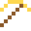

# Goldbarren

Alles je geförderte Gold passt in einen Würfel mit 22 m Kante. Es entstand, als Neutronensterne zusammenstießen.

| Eigenschaft | Wert |
|---|---|
| Symbol | Au |
| Ordnungszahl | 79 |
| Gruppe | Übergangsmetall |
| Zustand (20 °C) | fest |
| Dichte | 19,3 g/cm³ |
| Schmilzt bei | 1064 °C |
| Härte (Mohs) | 2,5 |
| Radioaktiv | nein, stabil |
| Ausrüstung daraus | ja |

## Herstellen

- 1 × [Golderz](../bloecke/golderz.md) → 1 × [Goldbarren](../elemente/goldbarren.md) (Ofen, 8 s)
- 1 × [Goldblock](../bloecke/goldblock.md) → 9 × [Goldbarren](../elemente/goldbarren.md) (von Hand, 1 s)
- 1 × [Tiefenschiefer-Golderz](../bloecke/tiefenschiefer_golderz.md) → 1 × [Goldbarren](../elemente/goldbarren.md) (Ofen, 8 s)

## Ausrüstung

Aus Goldbarren gibt es Werkzeuge, Waffen und Rüstung (Stufe 1):

-  Goldspitzhacke: 3 × Goldbarren + 2 × Bretter
-  Goldaxt: 3 × Goldbarren + 2 × Bretter
-  Goldschwert: 2 × Goldbarren + 1 × Bretter
-  Goldhelm: 5 × Goldbarren
-  Goldharnisch: 8 × Goldbarren
-  Goldbeinschutz: 7 × Goldbarren
-  Goldstiefel: 4 × Goldbarren

## Verwendet für

[Goldkabel](../gegenstaende/goldkabel.md), [Glasfaserkabel](../gegenstaende/glasfaserkabel.md), [Goldhelm](../gegenstaende/goldhelm.md), [Goldharnisch](../gegenstaende/goldharnisch.md), [Goldbeinschutz](../gegenstaende/goldbeinschutz.md), [Goldstiefel](../gegenstaende/goldstiefel.md), [Rotes Glas](../bloecke/rotes_glas.md), [Francium](../elemente/francium.md), [Elektrum](../legierungen/elektrum.md), [Weißgold](../legierungen/weissgold.md), [Rotgold](../legierungen/rotgold.md), [Goldblock](../bloecke/goldblock.md), [Goldener Apfel](../gegenstaende/goldener_apfel.md), [Goldene Karotte](../gegenstaende/goldene_karotte.md), [Feinwägeplatte](../bloecke/feinwaegeplatte.md)

