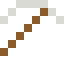

# Holmium

Das stärkste magnetische Moment aller Elemente.

| Eigenschaft | Wert |
|---|---|
| Symbol | Ho |
| Ordnungszahl | 67 |
| Gruppe | Lanthanoid |
| Zustand (20 °C) | fest |
| Dichte | 8,79 g/cm³ |
| Schmilzt bei | 1461 °C |
| Härte (Mohs) | 3 |
| Radioaktiv | nein, stabil |
| Ausrüstung daraus | ja |

## Herstellen

- 6 × [Seltenerd-Konzentrat](../gegenstaende/seltenerd_konzentrat.md) → 1 × [Holmium](../elemente/holmium.md) (Trennanlage, 28 s)

## Ausrüstung

Aus Holmium gibt es Werkzeuge, Waffen und Rüstung (Stufe 1):

-  Holmiumspitzhacke: 3 × Holmium + 2 × Bretter
-  Holmiumaxt: 3 × Holmium + 2 × Bretter
-  Holmiumschwert: 2 × Holmium + 1 × Bretter
-  Holmiumhelm: 5 × Holmium
-  Holmiumharnisch: 8 × Holmium
-  Holmiumbeinschutz: 7 × Holmium
-  Holmiumstiefel: 4 × Holmium

