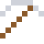

# Indium

So weich, dass es beim Biegen hörbar "schreit". Jeder Touchscreen hat eine durchsichtige Schicht aus Indiumzinnoxid.

| Eigenschaft | Wert |
|---|---|
| Symbol | In |
| Ordnungszahl | 49 |
| Gruppe | Metall |
| Zustand (20 °C) | fest |
| Dichte | 7,31 g/cm³ |
| Schmilzt bei | 157 °C |
| Härte (Mohs) | 1,2 |
| Radioaktiv | nein, stabil |
| Ausrüstung daraus | ja |

## Herstellen

- 3 × [Zinkrückstand](../gegenstaende/zinkrueckstand.md) → 1 × [Indium](../elemente/indium.md) (Trennanlage, 18 s)

## Ausrüstung

Aus Indium gibt es Werkzeuge, Waffen und Rüstung (Stufe 0 – zu weich, taugt nichts):

-  [Indiumspitzhacke](../elemente/indium.md): 3 × Indium + 2 × Bretter
-  [Indiumaxt](../elemente/indium.md): 3 × Indium + 2 × Bretter
-  [Indiumschwert](../elemente/indium.md): 2 × Indium + 1 × Bretter
-  [Indiumhelm](../gegenstaende/indiumhelm.md): 5 × Indium
-  [Indiumharnisch](../gegenstaende/indiumharnisch.md): 8 × Indium
-  [Indiumbeinschutz](../gegenstaende/indiumbeinschutz.md): 7 × Indium
-  [Indiumstiefel](../gegenstaende/indiumstiefel.md): 4 × Indium

## Verwendet für

[Galinstan](../legierungen/galinstan.md)

