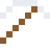

# Iridium

Eine dünne Iridiumschicht im Gestein überall auf der Welt verrät den Asteroiden, der die Dinosaurier auslöschte.

| Eigenschaft | Wert |
|---|---|
| Symbol | Ir |
| Ordnungszahl | 77 |
| Gruppe | Übergangsmetall |
| Zustand (20 °C) | fest |
| Dichte | 22,56 g/cm³ |
| Schmilzt bei | 2446 °C |
| Härte (Mohs) | 6,5 |
| Radioaktiv | nein, stabil |
| Ausrüstung daraus | ja |

## Herstellen

- 4 × [Platinmetall-Konzentrat](../gegenstaende/platinmetall_konzentrat.md) → 1 × [Iridium](../elemente/iridium.md) (Trennanlage, 30 s)

## Ausrüstung

Aus Iridium gibt es Werkzeuge, Waffen und Rüstung (Stufe 3):

-  Iridiumspitzhacke: 3 × Iridium + 2 × Bretter
-  Iridiumaxt: 3 × Iridium + 2 × Bretter
-  Iridiumschwert: 2 × Iridium + 1 × Bretter
-  Iridiumhelm: 5 × Iridium
-  Iridiumharnisch: 8 × Iridium
-  Iridiumbeinschutz: 7 × Iridium
-  Iridiumstiefel: 4 × Iridium

## Verwendet für

[Platin-Iridium](../legierungen/platin_iridium.md)

