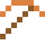
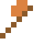

# Kupferbarren

Leitet Strom fast so gut wie Silber. Die Freiheitsstatue ist aus Kupfer – grün durch Patina.

| Eigenschaft | Wert |
|---|---|
| Symbol | Cu |
| Ordnungszahl | 29 |
| Gruppe | Übergangsmetall |
| Zustand (20 °C) | fest |
| Dichte | 8,96 g/cm³ |
| Schmilzt bei | 1085 °C |
| Härte (Mohs) | 3 |
| Radioaktiv | nein, stabil |
| Ausrüstung daraus | ja |

## Herstellen

- 1 × [Kupfererz](../bloecke/kupfererz.md) → 1 × [Kupferbarren](../elemente/kupferbarren.md) (Ofen, 5 s)
- 1 × [Kupferblock](../bloecke/kupferblock.md) → 9 × [Kupferbarren](../elemente/kupferbarren.md) (von Hand, 1 s)
- 1 × [Tiefenschiefer-Kupfererz](../bloecke/tiefenschiefer_kupfererz.md) → 1 × [Kupferbarren](../elemente/kupferbarren.md) (Ofen, 5 s)

## Ausrüstung

Aus Kupferbarren gibt es Werkzeuge, Waffen und Rüstung (Stufe 1):

-  [Kupferspitzhacke](../elemente/kupferbarren.md): 3 × Kupferbarren + 2 × Bretter
-  [Kupferaxt](../elemente/kupferbarren.md): 3 × Kupferbarren + 2 × Bretter
-  [Kupferschwert](../elemente/kupferbarren.md): 2 × Kupferbarren + 1 × Bretter
-  [Kupferhelm](../gegenstaende/kupferhelm.md): 5 × Kupferbarren
-  [Kupferharnisch](../gegenstaende/kupferharnisch.md): 8 × Kupferbarren
-  [Kupferbeinschutz](../gegenstaende/kupferbeinschutz.md): 7 × Kupferbarren
-  [Kupferstiefel](../gegenstaende/kupferstiefel.md): 4 × Kupferbarren

## Verwendet für

[Kupferdraht](../gegenstaende/kupferdraht.md), [Rohr](../gegenstaende/rohr.md), [Patronen](../gegenstaende/patronen.md), [Hohlspitzpatronen](../gegenstaende/hohlspitzpatronen.md), [Laservisier](../gegenstaende/laservisier.md), [Türkises Glas](../bloecke/tuerkises_glas.md), [Teleskop](../gegenstaende/teleskop.md), [Schiffsschraube](../bloecke/schiffsschraube.md), [Anodenschlamm](../gegenstaende/anodenschlamm.md), [Bronze](../legierungen/bronze.md), [Messing](../legierungen/messing.md), [Duraluminium](../legierungen/duraluminium.md), [Berylliumkupfer](../legierungen/berylliumkupfer.md), [Rotgold](../legierungen/rotgold.md), [Sterlingsilber](../legierungen/sterlingsilber.md), [Konstantan](../legierungen/konstantan.md), [Monel](../legierungen/monel.md), [Aluminiumbronze](../legierungen/aluminiumbronze.md), [Glockenbronze](../legierungen/glockenbronze.md), [Graphen](../gegenstaende/graphen.md), [Kupferblock](../bloecke/kupferblock.md), [Kupferkabel](../gegenstaende/kupferkabel.md)

