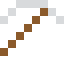
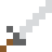

# Lutetium

Das letzte der Lanthanoide, eines der teuersten Metalle – und ein Mittel gegen Krebs.

| Eigenschaft | Wert |
|---|---|
| Symbol | Lu |
| Ordnungszahl | 71 |
| Gruppe | Lanthanoid |
| Zustand (20 °C) | fest |
| Dichte | 9,841 g/cm³ |
| Schmilzt bei | 1652 °C |
| Härte (Mohs) | 3,5 |
| Radioaktiv | nein, stabil |
| Ausrüstung daraus | ja |

## Herstellen

- 8 × [Seltenerd-Konzentrat](../gegenstaende/seltenerd_konzentrat.md) → 1 × [Lutetium](../elemente/lutetium.md) (Trennanlage, 34 s)

## Ausrüstung

Aus Lutetium gibt es Werkzeuge, Waffen und Rüstung (Stufe 2):

-  [Lutetiumspitzhacke](../elemente/lutetium.md): 3 × Lutetium + 2 × Bretter
-  [Lutetiumaxt](../elemente/lutetium.md): 3 × Lutetium + 2 × Bretter
-  [Lutetiumschwert](../elemente/lutetium.md): 2 × Lutetium + 1 × Bretter
-  [Lutetiumhelm](../gegenstaende/lutetiumhelm.md): 5 × Lutetium
-  [Lutetiumharnisch](../gegenstaende/lutetiumharnisch.md): 8 × Lutetium
-  [Lutetiumbeinschutz](../gegenstaende/lutetiumbeinschutz.md): 7 × Lutetium
-  [Lutetiumstiefel](../gegenstaende/lutetiumstiefel.md): 4 × Lutetium

