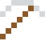

# Magnesium

Brennt mit gleißend weißem Licht, das sich nicht mit Wasser löschen lässt. Im Herzen jedes Chlorophylls sitzt ein Magnesium-Atom.

| Eigenschaft | Wert |
|---|---|
| Symbol | Mg |
| Ordnungszahl | 12 |
| Gruppe | Erdalkalimetall |
| Zustand (20 °C) | fest |
| Dichte | 1,738 g/cm³ |
| Schmilzt bei | 650 °C |
| Härte (Mohs) | 2,5 |
| Radioaktiv | nein, stabil |
| Ausrüstung daraus | ja |

## Herstellen

- 2 × [Dolomit](../bloecke/dolomit.md) + 1 × [Silizium](../elemente/silizium.md) → 1 × [Magnesium](../elemente/magnesium.md) (Induktionsofen, 15 s)

## Ausrüstung

Aus Magnesium gibt es Werkzeuge, Waffen und Rüstung (Stufe 1):

-  [Magnesiumspitzhacke](../elemente/magnesium.md): 3 × Magnesium + 2 × Bretter
-  [Magnesiumaxt](../elemente/magnesium.md): 3 × Magnesium + 2 × Bretter
-  [Magnesiumschwert](../elemente/magnesium.md): 2 × Magnesium + 1 × Bretter
-  [Magnesiumhelm](../gegenstaende/magnesiumhelm.md): 5 × Magnesium
-  [Magnesiumharnisch](../gegenstaende/magnesiumharnisch.md): 8 × Magnesium
-  [Magnesiumbeinschutz](../gegenstaende/magnesiumbeinschutz.md): 7 × Magnesium
-  [Magnesiumstiefel](../gegenstaende/magnesiumstiefel.md): 4 × Magnesium

## Verwendet für

[Bor](../elemente/bor.md), [Beryllium](../elemente/beryllium.md), [Zirconium](../elemente/zirconium.md), [Magnesiumlegierung](../legierungen/magnesiumlegierung.md)

