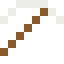

# Natrium

So weich, dass man es mit dem Messer schneidet – und in Wasser explodiert es. Mit dem giftigen Chlor wird es Kochsalz.

| Eigenschaft | Wert |
|---|---|
| Symbol | Na |
| Ordnungszahl | 11 |
| Gruppe | Alkalimetall |
| Zustand (20 °C) | fest |
| Dichte | 0,968 g/cm³ |
| Schmilzt bei | 98 °C |
| Härte (Mohs) | 0,5 |
| Radioaktiv | nein, stabil |
| Ausrüstung daraus | ja |
| Im Wasser | Feuerkugel |

## Im Wasser

2 Na + 2 H2O → 2 NaOH + H2: Natrium schmilzt zur Kugel, saust über das Wasser – dann entzündet sich der Wasserstoff mit gelber Flamme.

## Herstellen

- 2 × [Salz](../bloecke/salz.md) → 1 × [Natrium](../elemente/natrium.md) (Elektrolyseanlage, 8 s)

## Ausrüstung

Aus Natrium gibt es Werkzeuge, Waffen und Rüstung (Stufe 0 – zu weich, taugt nichts):

-  Natriumspitzhacke: 3 × Natrium + 2 × Bretter
-  Natriumaxt: 3 × Natrium + 2 × Bretter
-  Natriumschwert: 2 × Natrium + 1 × Bretter
-  Natriumhelm: 5 × Natrium
-  Natriumharnisch: 8 × Natrium
-  Natriumbeinschutz: 7 × Natrium
-  Natriumstiefel: 4 × Natrium

## Verwendet für

[NaK](../legierungen/nak.md)

