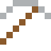
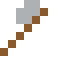
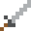

# Neptunium

Das erste Element nach dem Uran (1940) – nach Neptun benannt, wie Uran nach Uranus.

| Eigenschaft | Wert |
|---|---|
| Symbol | Np |
| Ordnungszahl | 93 |
| Gruppe | Actinoid |
| Zustand (20 °C) | fest |
| Dichte | 20,45 g/cm³ |
| Schmilzt bei | 639 °C |
| Härte (Mohs) | 4,5 |
| Radioaktiv | ja, Halbwertszeit 2,14 Mio. Jahre |
| Ausrüstung daraus | ja |

## Herstellen

- 4 × [Uran](../elemente/uran.md) + 1 × [Uranbrennstab](../gegenstaende/uranbrennstab.md) → 1 × [Neptunium](../elemente/neptunium.md) (Forschungsreaktor, 90 s)

## Ausrüstung

Aus Neptunium gibt es Werkzeuge, Waffen und Rüstung (Stufe 2):

-  Neptuniumspitzhacke: 3 × Neptunium + 2 × Bretter
-  Neptuniumaxt: 3 × Neptunium + 2 × Bretter
-  Neptuniumschwert: 2 × Neptunium + 1 × Bretter
-  Neptuniumhelm: 5 × Neptunium
-  Neptuniumharnisch: 8 × Neptunium
-  Neptuniumbeinschutz: 7 × Neptunium
-  Neptuniumstiefel: 4 × Neptunium

