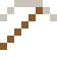

# Nickel

Viele Meteoriten sind aus Eisen und Nickel. In den USA heißt die 5-Cent-Münze einfach "Nickel".

| Eigenschaft | Wert |
|---|---|
| Symbol | Ni |
| Ordnungszahl | 28 |
| Gruppe | Übergangsmetall |
| Zustand (20 °C) | fest |
| Dichte | 8,908 g/cm³ |
| Schmilzt bei | 1455 °C |
| Härte (Mohs) | 4 |
| Radioaktiv | nein, stabil |
| Ausrüstung daraus | ja |

## Herstellen

- 1 × [Pentlandit](../bloecke/pentlandit.md) → 1 × [Nickel](../elemente/nickel.md) (Ofen, 6 s)

## Ausrüstung

Aus Nickel gibt es Werkzeuge, Waffen und Rüstung (Stufe 2):

-  [Nickelspitzhacke](../elemente/nickel.md): 3 × Nickel + 2 × Bretter
-  [Nickelaxt](../elemente/nickel.md): 3 × Nickel + 2 × Bretter
-  [Nickelschwert](../elemente/nickel.md): 2 × Nickel + 1 × Bretter
-  [Nickelhelm](../gegenstaende/nickelhelm.md): 5 × Nickel
-  [Nickelharnisch](../gegenstaende/nickelharnisch.md): 8 × Nickel
-  [Nickelbeinschutz](../gegenstaende/nickelbeinschutz.md): 7 × Nickel
-  [Nickelstiefel](../gegenstaende/nickelstiefel.md): 4 × Nickel

## Verwendet für

[Platinmetall-Konzentrat](../gegenstaende/platinmetall_konzentrat.md), [Darmstadtium](../elemente/darmstadtium.md), [Roentgenium](../elemente/roentgenium.md), [Neusilber](../legierungen/neusilber.md), [Invar](../legierungen/invar.md), [Nichrom](../legierungen/nichrom.md), [Schwermetall](../legierungen/schwermetall.md), [Nitinol](../legierungen/nitinol.md), [Alnico](../legierungen/alnico.md), [Permalloy](../legierungen/permalloy.md), [Konstantan](../legierungen/konstantan.md), [Monel](../legierungen/monel.md), [Hastelloy](../legierungen/hastelloy.md), [Maraging-Stahl](../legierungen/maraging_stahl.md)

